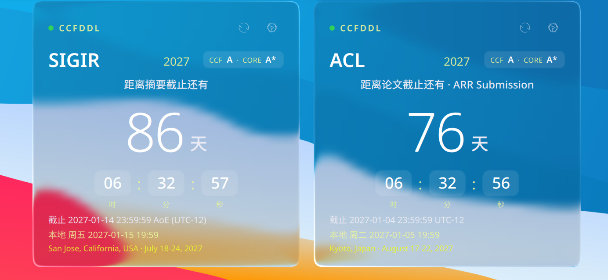
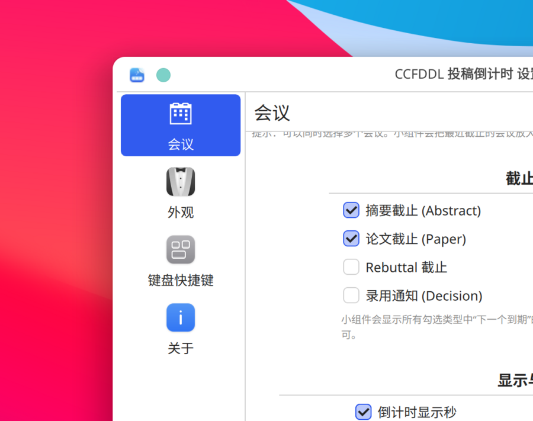

# CCFDDL 投稿倒计时（KDE Plasma 6 桌面小组件）

从 [ccfddl.com](https://ccfddl.com/) 拉取计算机学术会议的投稿截止日期，
在桌面上显示**醒目的投稿倒计时**（天 / 时 / 分 / 秒），
外观为参考 [liquidglass-kde-widgets](https://github.com/jaxparrow07/liquidglass-kde-widgets)
风格的**液态玻璃**材质。



## 功能

- 🔍 **会议跟踪**：在设置里勾选任意会议（ACL、SIGIR、NeurIPS、CVPR …，共 370+），
  支持搜索；可同时跟踪多个会议。
- ⏳ **倒计时优先**：自动把“最近截止”的会议放大显示为大号倒计时，
  其余会议以小行排列在下方（点击任意一行打开会议官网）。
- 📅 **截止类型**：可勾选摘要截止 / 论文截止 / Rebuttal / 录用通知，
  始终显示所选类型中下一个到期的时间。
- 🕒 **时区换算**：截止时间为会议官方时区（如 UTC-12、AoE），
  同时显示换算后的本地时间（含中文星期）。
- 🌐 **数据自动刷新**：默认每 6 小时从 ccfddl.com 拉取最新数据；
  断网时使用内置快照兜底，联网后自动恢复。
- 🎨 **液态玻璃外观**：圆角、折射、色散、高光、背景模糊全部可调，
  也提供纯色模式；支持深色 / 浅色 / 跟随系统。
- 🔔 **临近提醒变色**：截止 ≤7 天变橙色，≤2 天变红色（可关闭）。
- 🧩 **面板模式**：拖到面板时会显示紧凑的“ACL 76天”样式。



## 环境要求

- KDE Plasma **6.x**（在 Debian 13 + Plasma 6.3 上开发测试）
- 无需 sudo，无需编译

## 安装

```bash
./install.sh            # 安装（或更新）到 ~/.local/share/plasma/plasmoids
./install.sh --restart  # 安装并重启 plasmashell 立即生效
```

然后在桌面上右键 → **添加小组件** → 搜索 “CCFDDL” → 拖到桌面。

也可以打包分发：

```bash
./package.sh   # 生成 dist/ccfddl-deadline-1.0.0.plasmoid
```

## 使用

1. 右键小部件 → **配置会议**（或点右上角齿轮）。
2. 搜索并勾选要投稿的会议，例如 `ACL`、`SIGIR`。
3. 想单独盯一个会（比如只投 ACL），就只勾一个；
   想一次看多个，就勾多个，最近截止的会自动放大。
4. 点会议名打开会议官网；点右上角 ⟳ 手动刷新数据。

每个小部件实例的配置相互独立——想同时把 ACL 和 SIGIR 分开摆在桌面，
添加两个小部件、各自勾选即可。

## 数据来源与更新

- 在线数据：`https://ccfddl.com/conference/initial.json`
- 内置快照：`package/contents/data/snapshot.js`（断网兜底）
- 更新快照：`python3 tools/update-data.py`

## 目录结构

```
package/                 # 小部件本体（Plasma/Applet 包）
  metadata.json
  contents/
    ui/main.qml          # 主界面（倒计时卡片）
    ui/Countdown.js      # 时区解析 / 截止计算
    ui/components/       # 玻璃背景、倒计时块、徽章等
    ui/config/           # 设置页（会议选择 / 外观）
    config/main.xml      # KConfig 配置项
    data/snapshot.js     # 会议数据快照（断网兜底）
tools/update-data.py     # 重新生成快照
install.sh / package.sh  # 安装 / 打包
```

## 致谢与许可

- 液态玻璃背景、shader 与部分组件修改自
  [liquidglass-kde-widgets](https://github.com/jaxparrow07/liquidglass-kde-widgets)（GPL-3.0）。
- 会议数据来自 [CCFDDL](https://ccfddl.com/) 公开接口。
- 本仓库代码以 **GPL-3.0** 发布（见 LICENSE）。
